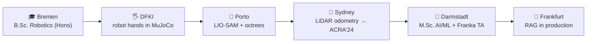

<!-- Header -->
<h1 align="center">Hey, I'm Mourad Ouazghire 👋</h1>

  

  <b>AI/ML @ TU Darmstadt · Robotics & AI · GenAI systems that actually ship</b>

    
    
    
    
    
    
    
    
    
    
    
    
    
    
    
    
    
    
    
    
    
    
    

sub-average github profile

  <a href="https://ouazmourad.github.io/mourad-ouazghire.github.io/">🌐 Website</a> ·
  <a href="https://scholar.google.com/citations?user=t1NZj80AAAAJ&hl=en&oi=ao">🎓 Google Scholar</a> ·
  <a href="https://www.linkedin.com/in/mourad-ouazghire-37830718a/">💼 LinkedIn</a>

---

### 🤖 The short version

- 🎓 M.Sc. **Artificial Intelligence & Machine Learning** @ **TU Darmstadt** — deep generative models, multimodal AI, NLP... professionally convincing matrices to have opinions
- 🦾 **TA @ PEARL Lab (Intelligent Robotic Manipulation)** — designing the lab assignments where **61 students** and one *very patient* **Franka Panda** figure out perception → planning → control together
- 🧠 **AI Developer @ BLACKLAKE, Frankfurt** — co-leading the AI department, shipping **RAG pipelines** and agentic workflows (n8n, Power Automate, or models trained from scratch) so companies' documents finally talk back
- 📄 Main-authored a **LiDAR odometry** paper at **ACRA 2024** — we benchmarked loop closure in an actual Australian botanic garden 🌿 (eucalyptus trees: surprisingly good landmarks)

### 🧭 My odometry so far

> computer, show em where we've been.

<i>Trajectory drift: accumulating · Loop closure: pending</i>

### 🔬 Field notes

- **Australian Centre for Robotics, Sydney** 🇦🇺 — main-authored *"Performance Assessment of LiDAR Odometry Frameworks: A Case Study with Loop Closure at Australian Botanic Garden Mount Annan"* ([ACRA 2024](https://scholar.google.com/citations?user=t1NZj80AAAAJ&hl=en&oi=ao))
- **Ingeniarius, Porto** 🇵🇹 — built a LIO-SAM pipeline turning LiDAR point clouds into octrees to spot novel environmental info fast. Big maps, small patience.
- **DFKI, Bremen** 🇩🇪 — simulated the anthropomorphic **MIA Hand** in MuJoCo for the EU APRIL project, and measured exactly how hard robot fingers squeeze (they should know their own strength)

### 📌 Things I've built (then broken, then rebuilt)

- **iRobMan_Franka** — Franka Panda perception–planning–control sims & tooling, straight from the PEARL Lab course I TA. The same assignments 61 students dream about (mostly at 3 a.m.)
- **COIN-LIO (fork)** — notes & experiments on intensity-augmented LiDAR-inertial odometry, for when geometry alone gets lost in long corridors
- **MarketOps_DBorse** — pipeline + evaluation for finance-ops use cases. The "GenAI that actually ships" department 📈

### 🧰 Stack

**The brains 🧠**

**The muscles 🦾**

**The glue 🔧**

### 🎲 Beyond the terminal

- 🗣️ **Languages:** English, French & Arabic (fluent) · German (C1) · Python (native) · C++ (it's complicated)
- 🏆 **2× DAAD RISE Worldwide Scholar** (2023 & 2024) — Germany kept sending me abroad to play with robots
- 🎪 Co-ran **jacobsHack!22**, one of Central Europe's biggest hackathons managing 5 departments

### 📊 The obligatory stats

<!-- If your GitHub username isn't "ouazmourad", swap it in both URLs below -->

  

  

### 📫 Say hi

📧 **mourad.ouazghire@stud.tu-darmstadt.de** · or DM on [LinkedIn](https://www.linkedin.com/in/mourad-ouazghire-37830718a/)

🛰️ README last calibrated: 2026 · sensor drift within acceptable bounds

