<!-- Animated SVGs live in assets/ and are generated by tools/build_assets.py -->

  
  
  

## 🧪 The lab

Side projects and hackathon builds. Each card links to its code.

<a href="https://github.com/ouazmourad/Kinexus"></a>

<a href="https://github.com/Geoshua/agora"></a>

<a href="https://github.com/ouazmourad/dimos-21-days-sprint/tree/feat/robot-telephone"></a>
<a href="https://github.com/ouazmourad/dimos-21-days-sprint/tree/feat/go2-gesture-control"></a>
<a href="https://github.com/ouazmourad/dimos-21-days-sprint/tree/g1-maze"></a>
<a href="https://github.com/ouazmourad/dimos-21-days-sprint/tree/animator-v1"></a>
<a href="https://github.com/ouazmourad/dimos-21-days-sprint/tree/feat/unitree-r1"></a>
<a href="https://github.com/ouazmourad/dimos-21-days-sprint/tree/feat/RL-pipeline"></a>
<a href="https://scholar.google.com/citations?user=t1NZj80AAAAJ&hl=en&oi=ao"></a>
<a href="https://github.com/ouazmourad/KF_BLueROV"></a>

## 📟 lab.log


Commit messages, unedited.

## 🧑‍🔬 By day

- **AI Developer, BLACKLAKE, Frankfurt**: RAG pipelines and agentic workflows
- **M.Sc. AI & Machine Learning, TU Darmstadt**
- **Teaching assistant, PEARL Lab**: Intelligent Robotic Manipulation, Franka Panda
- **ACRA 2024, main author**: LiDAR odometry and loop closure
- DAAD RISE Worldwide Scholar, 2023 and 2024 · jacobsHack!22 organizer
- English, French, Arabic, German (C1)
- Bremen → DFKI → Porto → Sydney → Darmstadt → Frankfurt

## 🧰 Toolbox

Also MuJoCo, Gazebo, PCL, n8n, Lightning.

---

    
    
    
    
    
    
    
    
    
    
    
    
    
    
    
    
    
    
    
    
    
    
    

